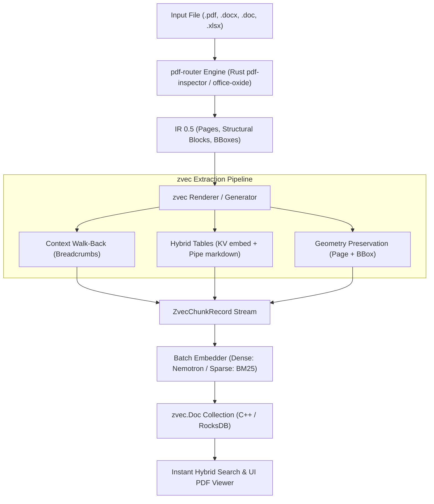
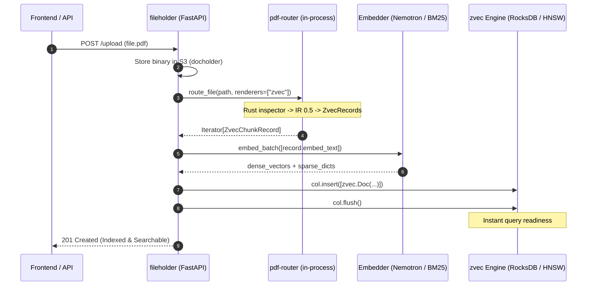

# ADR-0010: Native `zvec` Target for `pdf-router` & `fileholder`

- **Status:** Proposed
- **Date:** 2026-10-26
- **Context:** `pdf-router` (v0.7 IR 0.5) + `fileholder` (FastAPI + `zvec` 0.7.0)
- **Supersedes:** `parsers/_liteparse.py`, legacy `chunking.py` in `fileholder`
- **Related:** 
  - [ADR-0001: IR structural blocks](file:///home/scanum/pdf-router/docs/adr/0001-ir-structural-blocks.md)
  - [ADR-0006: RAG chunks renderer](file:///home/scanum/pdf-router/docs/adr/0006-rag-chunks.md)
  - [ADR-0009: Docling output format](file:///home/scanum/pdf-router/docs/adr/0009-docling-renderer.md)

---

## 1. Context and Problem Statement

The `fileholder` service is designed as an ultra-fast, local-first document storage and semantic search engine for construction project documentation and state expertise audits.

Currently, `fileholder` suffers from a severe impedance mismatch:
1. **Legacy Parsing Layer**: It relies on `liteparse` (yanked from PyPI), which converts incoming documents to intermediate PDF raster representations, stripping table structures and corrupting layout.
2. **Naive Chunking**: `chunking.py` slices text using fixed character windows (`CHUNK_SIZE = 1000`) and arbitrary newline splits, breaking tables across rows, severing headings from bodies, and dropping hierarchical context.
3. **Underutilized Vector Store**: While `zvec 0.7.0` provides blazing-fast C++/Rust hybrid vector and RocksDB scalar indexing, `fileholder` feeds it unrefined chunks with minimal scalar metadata.

Meanwhile, `~/pdf-router` already implements:
- Rust-native classification and extraction via Firecrawl's `pdf-inspector 1.17+`;
- Structured Intermediate Representation (IR 0.5) with `TableBlock`, `HeadingBlock`, and bounding boxes;
- Format-neutral ingestion (PDF, DOCX, XLSX, legacy DOC via `office-oxide`, DJVU).

### Why not Docling?
While Docling ([ADR-0009](file:///home/scanum/pdf-router/docs/adr/0009-docling-renderer.md)) provides an interchange document tree for generalized LLM frameworks, it incurs heavy serialization overhead and requires complex flattening before ingestion into vector stores. `zvec` requires flat, strongly-typed `zvec.Doc` records. 

A dedicated `zvec` target bridges `pdf-router`'s IR directly to `zvec` records with zero intermediate overhead, guaranteed determinism, and full geometric awareness.

---

## 2. Decision: Dedicated `zvec` Target

We introduce a first-class `zvec` renderer (`pdf_router.renderers.zvec`) and Python generator API (`iter_zvec_docs`) in `pdf-router`, coupled with a refactored ingestion pipeline in `fileholder`.



---

## 3. Data Contract: `zvec` Schema Specification

The `zvec` collection schema is upgraded to reflect the full fidelity of construction and engineering documentation:

### 3.1 Collection Schema

```python
import zvec

ZVEC_SCHEMA = zvec.CollectionSchema(
    name="fileholder",
    fields={
        # Identity & Relations
        "project_uid":   zvec.FieldSchema(zvec.DataType.STRING, nullable=False),
        "doc_uid":       zvec.FieldSchema(zvec.DataType.STRING, nullable=False),
        "doc_name":      zvec.FieldSchema(zvec.DataType.STRING, nullable=False, index_param={"enable_range_optimization": True}),
        
        # Structural Typification
        "chunk_type":    zvec.FieldSchema(zvec.DataType.STRING, nullable=False, index_param={"enable_range_optimization": True}),
        "chunk_index":   zvec.FieldSchema(zvec.DataType.INT32, nullable=False),
        
        # Spatial / Visual Provenance (for UI Viewer)
        "page_num":      zvec.FieldSchema(zvec.DataType.INT32, nullable=False, index_param={"enable_range_optimization": True}),
        "bbox":          zvec.FieldSchema(zvec.DataType.STRING, nullable=False), # JSON: [x0, y0, x1, y1] or "[]"
        
        # Hierarchy & Content
        "section_path":  zvec.FieldSchema(zvec.DataType.STRING, nullable=False, index_param={"enable_range_optimization": True}),
        "content":       zvec.FieldSchema(zvec.DataType.STRING, nullable=False), # Authoritative Markdown
        "table_facts":   zvec.FieldSchema(zvec.DataType.STRING, nullable=False), # JSON summary of numeric cols
    },
    vectors={
        "dense": zvec.VectorSchema(
            zvec.DataType.VECTOR_FP32,
            dimension=2048, # Matching Nemotron / BGE-M3
            index_param={"type": "HNSW", "metric_type": "COSINE", "m": 16, "ef_construction": 200}
        ),
        "sparse": zvec.VectorSchema(
            zvec.DataType.SPARSE_VECTOR_FP32,
            dimension=0,
            index_param={"metric_type": "IP"}
        ),
    }
)
```

### 3.2 Field Descriptions

| Field | Type | Indexed | Purpose | Example |
|---|---|---|---|---|
| `id` | PK (`str`) | Yes | Deterministic record ID | `09dcbd89_p04_t01_pt0` |
| `project_uid` | `STRING` | Filter | Multi-tenant isolation | `fb387ca9-9b79-4377...` |
| `doc_uid` | `STRING` | Filter | File-level scoping & deletion | `09dcbd89-94dc-4a4a...` |
| `doc_name` | `STRING` | Scalar Index | Clean official document title | `Раздел 4. Том 4.2. КНС ТХ` |
| `chunk_type` | `STRING` | Scalar Index | Selective filtering (`text`/`table`/`heading`) | `table` |
| `page_num` | `INT32` | Range Index | Physical sheet / page (1-indexed) | `4` |
| `bbox` | `STRING` | Payload | Bounding box on sheet for UI highlight | `[54.2, 120.0, 540.8, 380.5]` |
| `section_path` | `STRING` | Scalar Index | Hierarchical breadcrumb walk-back | `Том 4.2 > КНС > Расчет насосов` |
| `content` | `STRING` | Inverted | Verbatim Markdown pipe grid or text | `\| Насос \| Q (м3/ч) \| H (м) \|` |
| `table_facts` | `STRING` | Payload | Deterministic numerical facts | `{"cols": {"H": {"min": 12, "max": 45}}}` |

---

## 4. Key Engineering Contracts

### 4.1 Deterministic Record IDs
Record IDs are fully deterministic and idempotent:
$$\text{ID} = \text{doc\_uid} \mathbin{\Vert} \text{\_p} \mathbin{\Vert} \text{page:02d} \mathbin{\Vert} \text{\_} \mathbin{\Vert} \text{type} \mathbin{\Vert} \text{index:02d}$$
*Example:* `09dcbd89-94dc_p04_table01` or `09dcbd89-94dc_p04_text02`.
Re-running the pipeline yields byte-identical IDs, enabling atomic upserts without ghost duplicates.

### 4.2 The "Embed vs. Content" Separation
Embedding models fail when searching bare table markdown (`| 12 | 450 | 32 |`). LLMs fail when given key-value dumps.
The `zvec` target emits two distinct textual representations per chunk:
1. **`embed_text` (fed to Dense + Sparse Vectorizer)**:
   ```text
   Раздел 4. Том 4.2. КНС ТХ › Насосная станция › Параметры насосных агрегатов
   Марка: Flygt NP 3153; Подача Q: 150 м3/ч; Напор H: 35 м; Мощность: 15 кВт.
   ```
2. **`content` (stored in `fields["content"]` and presented to LLM / UI)**:
   ```markdown
   ### Параметры насосных агрегатов
   | Марка | Подача Q (м3/ч) | Напор H (м) | Мощность (кВт) |
   |---|---|---|---|
   | Flygt NP 3153 | 150 | 35 | 15 |
   ```

### 4.3 Table Processing Rules
Following [ADR-0006](file:///home/scanum/pdf-router/docs/adr/0006-rag-chunks.md):
- **Atomic Rows**: Tables exceeding the token budget are split across row boundaries. Header rows and breadcrumbs are prepended to every part (`part 1/3`, `part 2/3`).
- **Caption Demotion**: Single-cell top rows (e.g., `Таблица 2.1 — Ведомость объемов`) are extracted into the chunk caption and breadcrumb trail.
- **Pipe Subtraction**: Text chunks subtract table regions on native and OCR pages to prevent duplicate indexing of scrambled raw OCR strings.

---

## 5. Integration Architecture in `fileholder`



### 5.1 Batch Optimization Policy
In the existing prototype, `_col.optimize()` was invoked synchronously after every single file, blocking I/O and rebuilding HNSW trees repeatedly.
* **New Policy**:
  - `_col.insert()` + `_col.flush()` per file (immediately searchable via memory buffers).
  - `_col.optimize()` is scheduled as a debounced background maintenance task (triggered after an ingestion batch completes or on an idle timer).

---

## 6. Implementation Deliverables

1. **`pdf-router` Module**:
   - Create [`src/pdf_router/renderers/zvec.py`](file:///home/scanum/pdf-router/src/pdf_router/renderers/zvec.py) implementing `render(ir, config)` and `iter_records(ir, config)`.
   - Register `"zvec": (render_zvec, ".zvec.jsonl")` in `pdf_router/api.py`.
   - Add ADR document `docs/adr/0010-zvec-renderer.md`.
2. **`fileholder` Refactoring**:
   - Remove `parsers/_liteparse.py`, `parsers/_doc.py`, and `chunking.py`.
   - Update `pyproject.toml` to depend directly on `pdf-router`.
   - Update `search.py` schema with new scalar indexes (`chunk_type`, `page_num`, `bbox`, `section_path`).
   - Migrate background indexer to use `pdf_router.api.route_file(..., renderers=["zvec"])`.
3. **Verification**:
   - Run tests on real project volumes (`Том 4.2 КНС.pdf`, `СП 267.pdf`).
   - Verify zero loss of tables, accurate bboxes, and sub-millisecond scalar-filtered hybrid queries.
