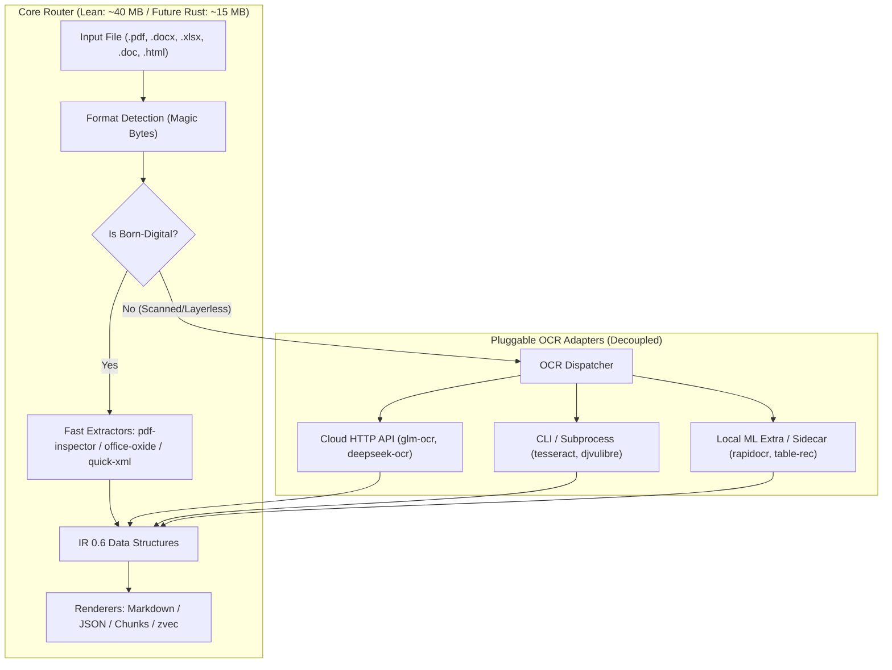

# ADR-0011: The Lean Router — Decoupling Heavy ML & Roadmap to Pure Rust

- **Status:** Accepted
- **Date:** 2026-11-15
- **Context:** Project bloat (807+ MB `.venv`), slow test suites, violation of single responsibility (router vs. heavy in-process CV lab), and alignment with core project ideals: 0 overhead, ultra-speed, minimal resource consumption, agent- and human-friendly DX.
- **Related:**
  - [ADR-0001: IR structural blocks](0001-ir-structural-blocks.md)
  - [ADR-0002: DocLang not as IR](0002-doclang-not-as-ir.md)
  - [ADR-0005: OCR structure pass](0005-ocr-structure.md)
  - [ADR-0008: Office ingest (docx, xlsx, doc)](0008-office-ingest.md)
  - [ADR-0010: Native zvec target](0010-zvec-renderer.md)

---

## 1. Context and Problem Statement

`pdf-router` was created as an ultra-minimal, deterministic, lightweight router around the high-speed Rust tool `pdf-inspector`. Its original role was to inspect incoming documents, route born-digital files to instantaneous extractors, and delegate scanned documents.

Over time, to solve real anchor needs on scanned Russian technical documentation (recovering tables and headings without cloud dependency), the project grew an in-process Computer Vision stack: RapidOCR (PP-OCRv6/v5), PP-Structure (rapid-layout), and TableStructureRec (lineless and wired table recognition on ONNXRuntime).

While this solved functional requirements, it caused severe architectural drift:
1. **Packaging Tax & Bloat:** Mandatory dependencies in `pyproject.toml` pulled in `opencv-python` (188 MB with video decoders), `scipy` (111 MB), `onnxruntime` (61 MB), `numpy` (60 MB), and embedded ONNX models (100+ MB). The `.venv` expanded past 800 MB, and Docker images grew past 2 GB.
2. **Violation of Single Responsibility:** A *router* (whose mission is fast classification and dispatching) became a monolithic neural network runner on CPU taking 20–30s per scanned page.
3. **Friction for Born-Digital Workflows:** 90% of office files (PDF with text, DOCX, XLSX, DOC, HTML) require zero OCR and process in milliseconds. Forcing these workflows to install 800 MB of CV wheels contradicts the "0 overhead" ideal.
4. **Agent and Developer Experience:** Slow test runs, fragile system dependencies (`libGL`, `openblas`), and high memory spikes (1.5 GB RSS) hinder autonomous agents and human developers alike.

---

## 2. Decision: Two-Phase Evolution

We adopt a two-phase strategy:
- **Phase 1 (Immediate / Python):** The Lean Router — Decouple heavy ML dependencies into an optional extra (`ocr-local`). Restore an ultra-light core.
- **Phase 2 (Architectural Target / Rust):** Roadmap to a pure-Rust single binary (`pdf-router-rs`), keeping OCR behind clean pluggable traits.



---

## 3. Phase 1: Decoupling Heavy ML in Python (Immediate)

### 3.1. Packaging Contract
Heavy computer vision and ONNX runtime packages are removed from `[project.dependencies]` and placed into `[project.optional-dependencies].ocr-local`:

- **Core Dependencies:**
  - `pdf-inspector >= 1.17` (fast Rust inspection & text extraction)
  - `office-oxide == 0.1.12` (fast Rust legacy `.doc` parser)
  - `pymupdf >= 1.27` (raster seam & PDF fallback)

- **Optional Extras:**
  - `ocr-local`: `rapidocr[onnxruntime]`, `lineless-table-rec`, `wired-table-rec`, `rapid-layout`, `onnxruntime`
  - `tesseract`: `pytesseract`
  - `cloud`: `requests`
  - `docling`: `docling-core`
  - `dev`: `pytest`, `ruff`, `mypy`

### 3.2. Fail-Fast Diagnostics
If a scanned document or configuration requests `rapidocr` or local table reconstruction when `ocr-local` is not installed, the router raises explicit, actionable exceptions (`OcrError`, `StructureError`) directing the user or agent to install the extra:
```
OcrError: rapidocr is not installed. Install with `uv sync --extra ocr-local` (or `pip install 'pdf-router[ocr-local]'`) or configure an alternative engine (e.g. tesseract, glm_ocr, deepseek_ocr).
```

### 3.3. Immediate Benefits
- Core install size drops from ~800 MB to ~70 MB.
- Born-digital processing requires zero OpenCV, SciPy, or ONNXRuntime.
- Package import time drops to near-zero.
- CI and dev setups become fast and resilient.

---

## 4. Phase 2: Architectural Roadmap to Pure Rust (`pdf-router-rs`)

For true 0-overhead, sub-millisecond execution, and rock-solid maintainability, the router core naturally belongs in Rust:

### 4.1. Core Components in Rust
1. **Binary & CLI:** Single standalone binary (~15–20 MB), zero runtime dependencies, instant execution (<2 ms), minimal memory footprint (<20 MB RSS).
2. **Format Detection:** Pure Rust magic-byte detection.
3. **Engines:**
   - PDF: Direct integration with `pdf-inspector` as an internal/shared crate (eliminating PyO3 marshaling overhead).
   - DOC: Direct integration with `office-oxide` Rust crate.
   - DOCX & XLSX: High-performance streaming OOXML parsers using `zip` + `quick-xml` / `roxmltree` (30–50x faster than Python ElementTree, zero allocation overhead).
   - HTML: `lol-html` / `scraper`.
4. **IR & Renderers:** Strongly typed `serde` structs. Native emission of Markdown, RAG JSONL chunks, and direct zero-copy `zvec` Doc records (ADR-0010).

### 4.2. OCR Separation Principle
To avoid re-introducing C++ shared library bloat into the Rust binary, OCR remains an external contract:
- Built-in lightweight engines: HTTP cloud clients (`reqwest`) and external CLI (`tesseract`, `djvulibre`).
- Heavy local neural models (PP-OCR, PP-Structure) are deployed either as an optional feature flag (`--features ocr-onnx`) or as an isolated sidecar process, keeping the router core pure and lean.

---

## 5. Consequences

- **Positive:**
  - Restores the original vision of `pdf-router` as a nimble, ultra-fast routing tool.
  - Huge disk savings (800+ MB reclaimed for core users).
  - Clear, modular boundary between fast data extraction and heavy neural inference.
  - Clear roadmap towards single-binary distribution in Rust.
- **Negative / Migration:**
  - Workflows requiring local offline OCR on scanned PDFs must specify `--extra ocr-local` when installing.
